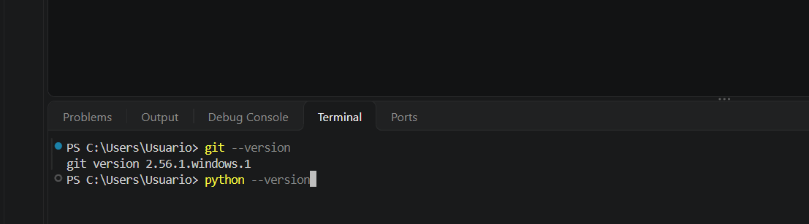
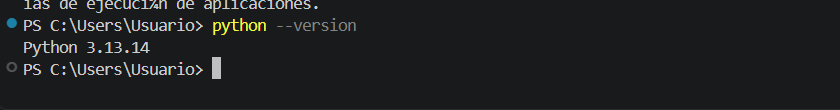
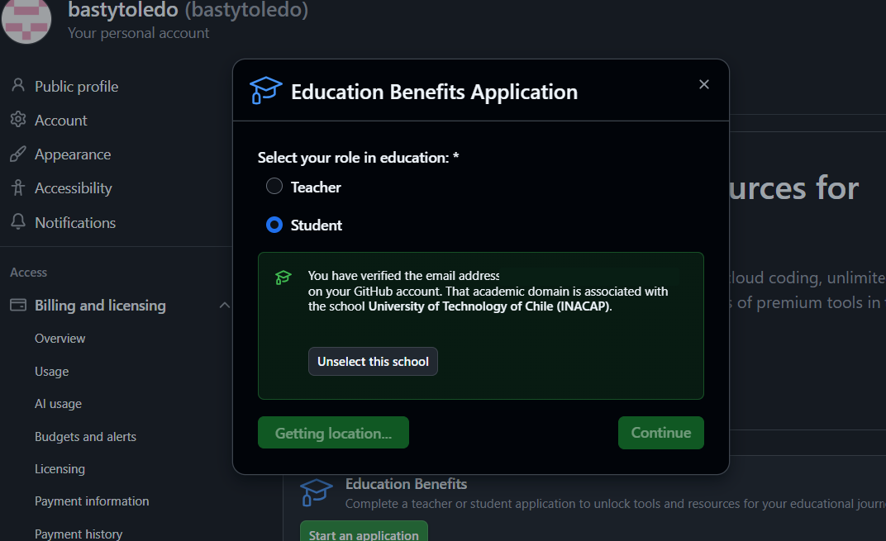
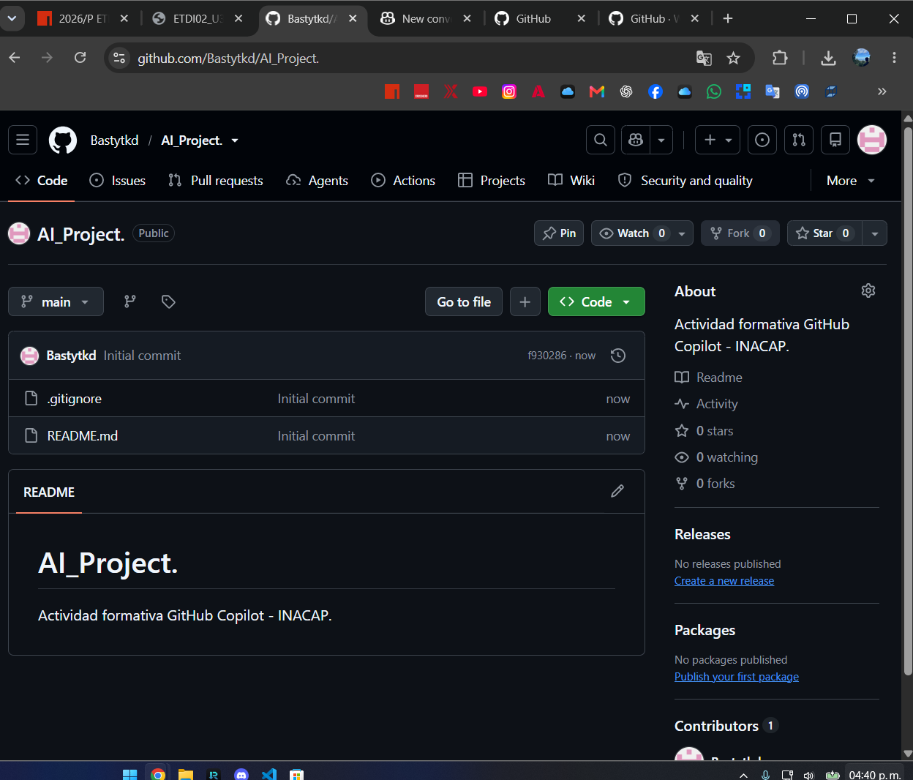
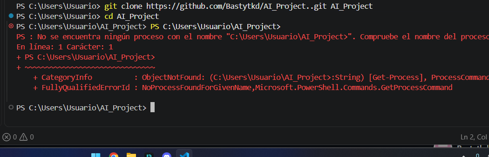
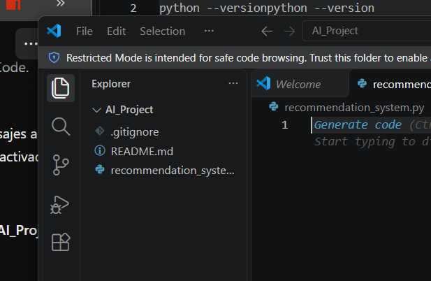
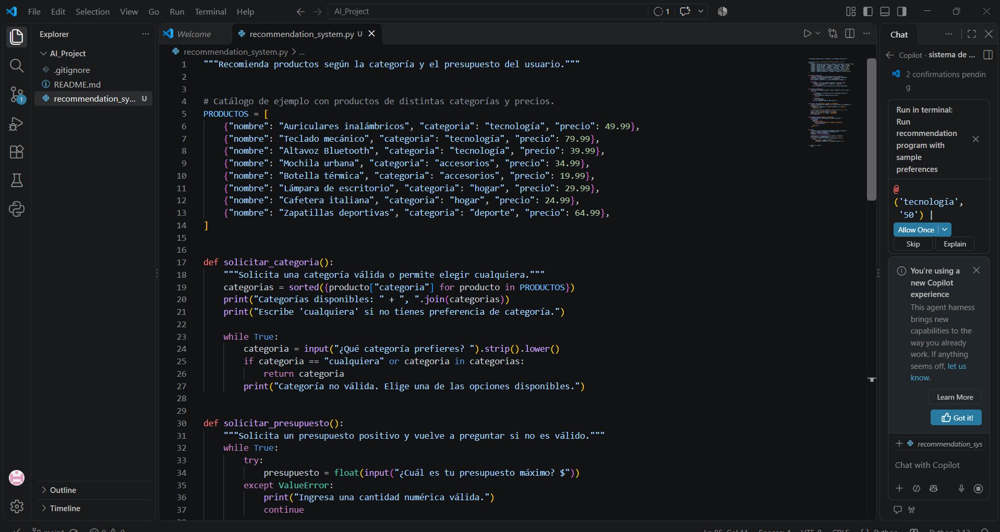
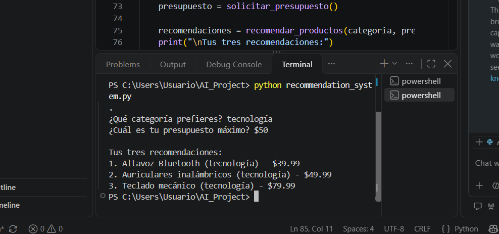

# Actividad formativa: GitHub Copilot

**Institución:** INACAP  
**Actividad:** ETDI02 – Unidad 3, Semana 14  
**Repositorio:** [AI_Project.](https://github.com/Bastytkd/AI_Project.)  
**Herramientas utilizadas:** GitHub, GitHub Copilot, Visual Studio Code, Git y Python.

## 1. Objetivo de la actividad

Explorar el uso de una herramienta de inteligencia artificial aplicada a la programación mediante **GitHub Copilot**, creando un proyecto de Python, ejecutándolo localmente y documentando el procedimiento en un repositorio de GitHub.

## 2. Preparación del entorno

Se comprobó desde la terminal integrada de Visual Studio Code que las herramientas necesarias estaban instaladas y operativas:

- **Git:** versión 2.56.1.windows.1.
- **Python:** versión 3.13.14.
- **Editor:** Visual Studio Code, en Windows.

Comandos utilizados:

```powershell
git --version
python --version
```

**Evidencias de la verificación:**





## 3. Cuenta de GitHub y solicitud educativa

Se inició sesión en GitHub y se inició una solicitud de beneficios de **GitHub Education** con la opción *Student*. La plataforma reconoció el correo institucional verificado y la asociación con INACAP. Durante el procedimiento se produjo una dificultad en la comprobación de ubicación (*Getting location...*), por lo que **esta evidencia no acredita que la solicitud de beneficios estudiantiles haya sido aprobada**.

La actividad de programación se desarrolló utilizando las funciones de GitHub Copilot disponibles en Visual Studio Code.



## 4. Creación del repositorio

Se creó un repositorio **público** en GitHub con los archivos iniciales `README.md` y `.gitignore`. El nombre visible del repositorio quedó como `AI_Project.` (incluye un punto final).

**Enlace del repositorio:** [https://github.com/Bastytkd/AI_Project.](https://github.com/Bastytkd/AI_Project.)



## 5. Clonación del repositorio y configuración local

Se clonó el repositorio desde Visual Studio Code. Debido al punto final del nombre en GitHub y a las restricciones de nombres de carpeta en Windows, se indicó expresamente una carpeta local sin punto final:

```powershell
git clone https://github.com/Bastytkd/AI_Project..git AI_Project
cd AI_Project
```

Se comprobó posteriormente que la terminal se encontraba en `C:\Users\Usuario\AI_Project` y que Visual Studio Code mostraba los archivos del repositorio.



## 6. Generación del programa con GitHub Copilot

Dentro de la carpeta local se creó `recommendation_system.py`. Se solicitó a GitHub Copilot generar un sistema básico de recomendación de productos en Python con comentarios en español, categorías de productos y selección mediante preferencias del usuario.

El programa producido contiene:

1. Un catálogo de **ocho productos** con nombre, categoría y precio.
2. Una función que solicita una categoría válida o la opción `cualquiera`.
3. Una función que solicita y valida un presupuesto positivo.
4. Un algoritmo que calcula una **puntuación de coincidencia** según categoría y precio.
5. Una salida con los **tres productos mejor puntuados**.

El programa utiliza únicamente funciones y estructuras propias de Python, sin dependencias externas indicadas en el código compartido.





## 7. Ejecución y resultados

Para ejecutar el programa se utilizó la terminal de Visual Studio Code:

```powershell
python recommendation_system.py
```

Se realizó una prueba con los siguientes datos:

| Dato de entrada | Valor |
| --- | --- |
| Categoría solicitada | `tecnología` |
| Presupuesto máximo | `50` |

La ejecución mostró estas tres recomendaciones:

| Posición | Producto | Precio |
| --- | --- | ---: |
| 1 | Altavoz Bluetooth | $39.99 |
| 2 | Auriculares inalámbricos | $49.99 |
| 3 | Teclado mecánico | $79.99 |

**Resultado:** el programa se ejecutó sin errores en la prueba mostrada. Se observó que el tercer producto supera el presupuesto ingresado: esto ocurre porque el algoritmo reduce la puntuación de los productos más caros, pero **no los descarta por completo**. Esta es una posible mejora futura, no una evidencia de que el programa no haya ejecutado.



## 8. Archivos del proyecto

La estructura prevista del repositorio después de incorporar esta documentación es:

```text
AI_Project/
├── recommendation_system.py
├── README.md
├── .gitignore
└── evidencias/
    ├── 01-verificacion-git.png
    ├── 02-verificacion-python.png
    ├── 03-solicitud-github-education.png
    ├── 04-repositorio-creado.png
    ├── 05-clonacion-terminal.png
    ├── 06-archivo-python-creado.png
    ├── 07-copilot-codigo.png
    └── 08-ejecucion-programa.png
```

## 9. Publicación de los archivos en GitHub

Una vez guardados el archivo de Python, el README y las evidencias en la carpeta local, los cambios se publican desde la terminal del proyecto mediante:

```powershell
git add .
git commit -m "Actividad formativa GitHub Copilot: codigo y evidencias"
git push origin main
```

**Nota de registro:** al momento de preparar este documento, las capturas compartidas confirmaban la ejecución local del programa, pero **no se había mostrado evidencia de la ejecución final de `git push`**. Por lo tanto, este apartado se presenta como procedimiento de publicación y debe comprobarse en GitHub antes de la entrega.

## 10. Conclusión

El ejercicio permitió utilizar **GitHub Copilot** como apoyo para generar código en Python, comprobar el funcionamiento del programa desde Visual Studio Code y conocer las operaciones básicas de un repositorio GitHub. La principal mejora identificada consiste en excluir productos que superen el presupuesto máximo cuando este se interprete como una restricción estricta.

---

*Documentación preparada a partir del procedimiento y las capturas registradas durante la actividad. Las imágenes se incluyen en la carpeta `evidencias/`.*
